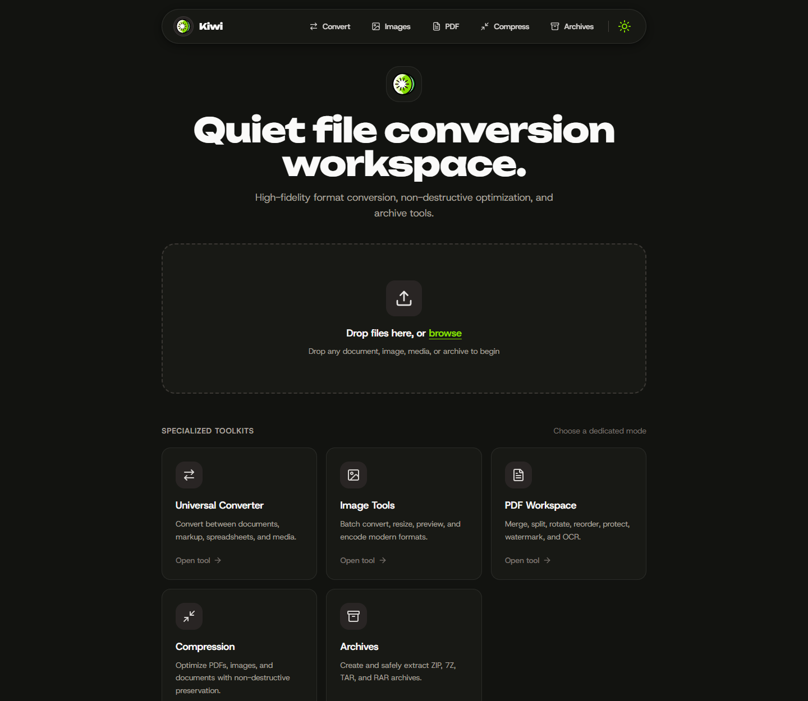
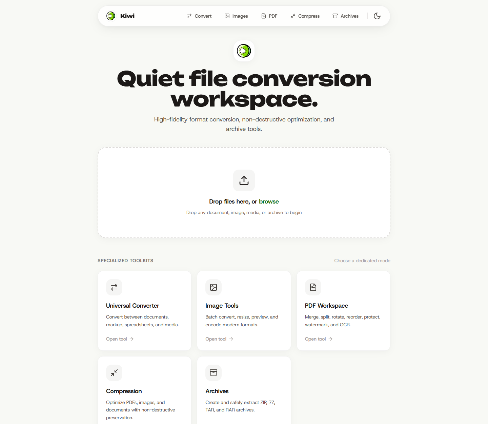
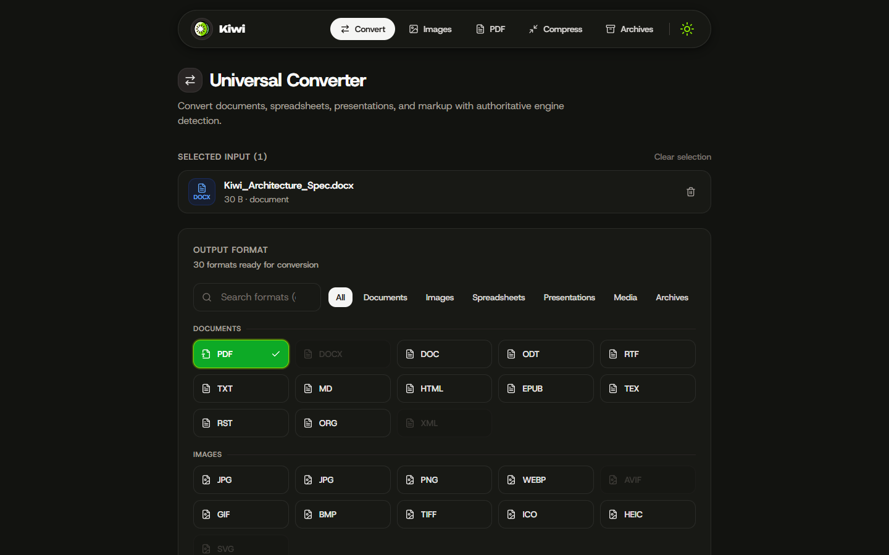
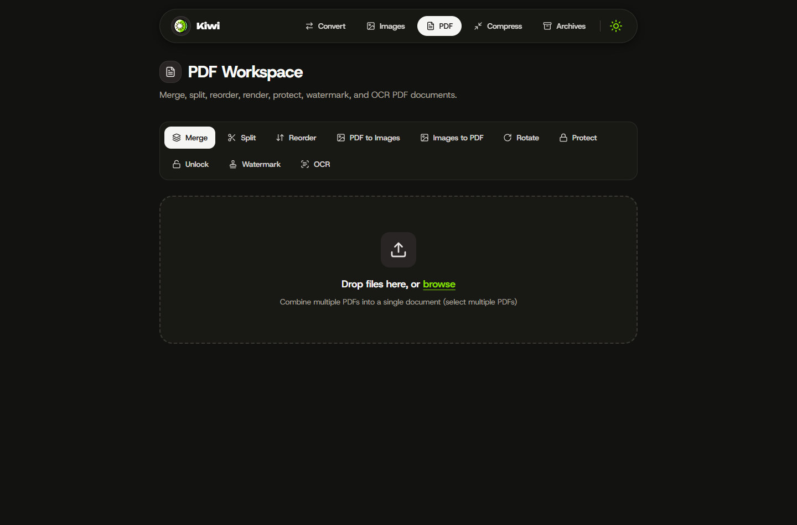
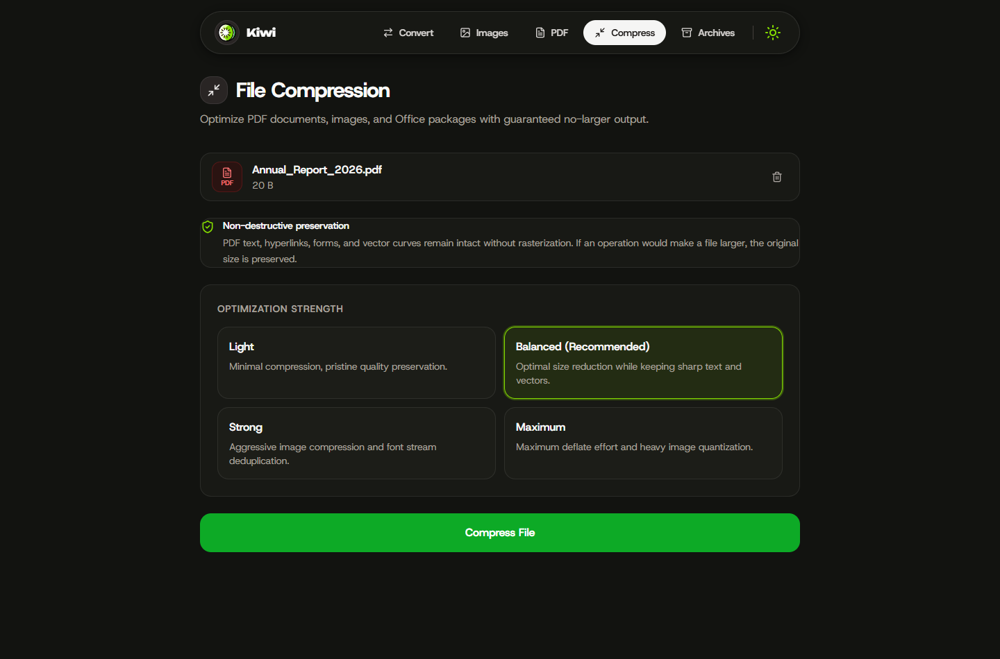
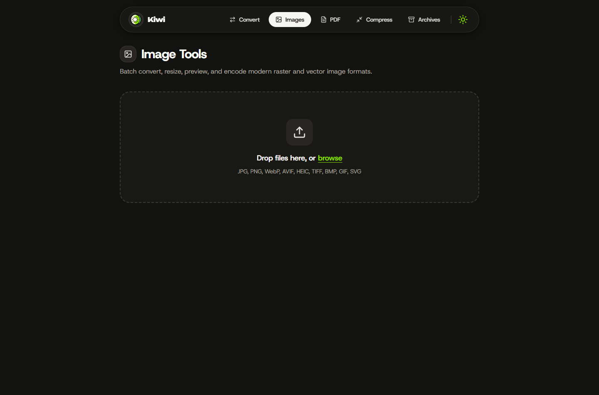
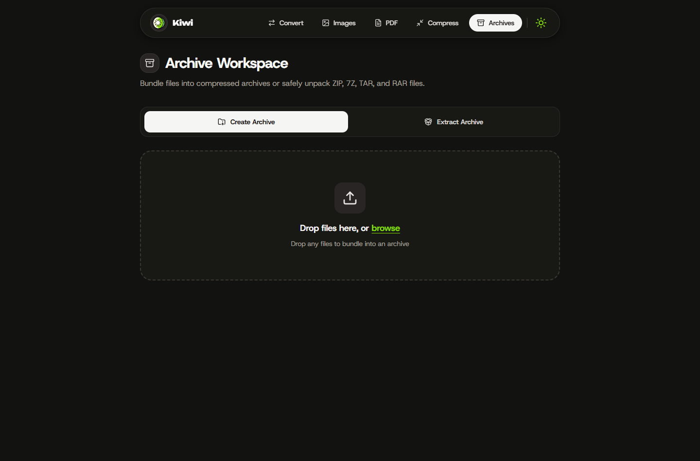

<div align="center">

  

  # Kiwi 🥝

  **The quiet, private, local-first file conversion and compression workspace.**

  Transform documents, images, audio, video, PDFs, and archives completely offline on your own machine.  
  Zero cloud uploads. Zero telemetry. Zero subscriptions. Uncompromising privacy.

  <p align="center">
    <a href="#key-features"></a>
    <a href="#architecture"></a>
    <a href="#architecture"></a>
    <a href="#architecture"></a>
    <a href="#license"></a>
  </p>

  <p align="center">
    <a href="#why-kiwi">Why Kiwi</a> •
    <a href="#visual-tour">Visual Tour</a> •
    <a href="#key-features">Features</a> •
    <a href="#supported-formats">Supported Formats</a> •
    <a href="#architecture">Architecture</a> •
    <a href="#getting-started">Getting Started</a> •
    <a href="#configuration">Configuration</a>
  </p>

</div>

---

<div align="center">
  
  <p><em>Desktop Workspace: Apple-inspired floating navigation capsule, minimal visual noise, and specialized file utility suites.</em></p>
</div>

<details>
  <summary><b>☀️ Prefer Light Mode? Click to preview Kiwi in Light Theme</b></summary>
  <br />
  <div align="center">
    
    <p><em>Light Mode: Warm cream-white tones (<code>#F8F9F5</code>) with focused kiwi-green accents and authentic typography.</em></p>
  </div>
</details>

---

## 💡 Why Kiwi?

Most online file converters:
- ❌ **Upload confidential files to remote servers** (tax documents, client contracts, private credentials, legal filings).
- ❌ **Enforce predatory limits** (file size paywalls, queue throttling, hourly conversion quotas).
- ❌ **Degrade quality silently** (rasterizing vector PDFs into low-res bitmaps, destructive JPEG recompression).
- ❌ **Clutter the experience** with ad trackers, dark patterns, and mandatory account registration.

**Kiwi is built differently:**
- 🛡️ **100% Offline & Local-First:** Every single conversion, extraction, and compression runs inside isolated temporary workspaces on your CPU and GPU.
- 🔒 **Zero Telemetry & Zero Leakage:** No third-party network pings, no cloud queues, and zero remote font/script requests.
- 💎 **Non-Destructive Processing:** Smart vector subsetting, lossless compression streams, and container repacking—preserving pristine vector lines, forms, and hyperlinks.
- ⚡ **Bounded System Footprint:** Strict streaming upload quotas, admission control backpressure, process tree isolation, and hard TTL auto-purges protect your machine's memory and disk.

---

## 📸 Visual Tour & Workspaces

### 1. Universal Document Converter
> Seamlessly convert documents, spreadsheets, presentations, and markup with single-source authoritative capability resolution.

<div align="center">
  
</div>

- **Batch Multi-File Intersection:** Automatically calculates the intersection of target formats supported across all selected files.
- **Honest Capability Matrix:** Formats clearly report real-time status: `ready`, `requires_engine`, `degraded_or_lossy`, or `content_dependent`. No fake extension renaming.
- **Categorized Format Picker:** Instant search and category filtering across Documents, Spreadsheets, Presentations, Images, Media, and Archives.

---

### 2. PDF Workspace & Toolkit
> Full-featured PDF manipulation suite with both visual operations and optical character recognition.

<div align="center">
  
</div>

- **Merge & Split:** Combine multiple documents or slice pages into dedicated PDF files.
- **Visual Reorder & Rotate:** Adjust page orientations and rearrange page order effortlessly.
- **PDF ⇄ Images:** Extract PDF pages into crisp images or compile image collections into unified PDF booklets.
- **Security & Privacy:** Add AES password protection or unlock protected documents.
- **Watermark & OCR:** Stamp custom text or graphic watermarks and run local optical character recognition (OCR) via Tesseract.

---

### 3. Non-Destructive Compression Studio
> Optimize multi-megabyte PDFs, images, and Office documents with guaranteed no-larger output protection.

<div align="center">
  
</div>

- **Vector & Font Preservation:** PDF optimization utilizes Ghostscript stream compaction and PyMuPDF font subsetting—**never** destructive rasterization.
- **Office Package Optimizer:** Recursively extracts and recompresses embedded media assets inside DOCX, PPTX, and XLSX zip containers.
- **No-Larger Guarantee:** If a file cannot be compressed further without quality loss, the original file is preserved untouched.

---

### 4. Image Studio & Archive Manager
<div align="center">
  <table>
    <tr>
      <td width="50%" align="center">
        <b>Modern Image Encoders</b><br />
        
        <br />
        <em>Batch re-encode JPG, PNG, WEBP, AVIF, HEIC, TIFF, and SVG with contain/exact scaling controls.</em>
      </td>
      <td width="50%" align="center">
        <b>Hardened Archive Vault</b><br />
        
        <br />
        <em>Create and safely extract ZIP, 7Z, TAR, and RAR archives with Zip Slip traversal protection.</em>
      </td>
    </tr>
  </table>
</div>

---

## 📊 Supported Formats

| Category | Formats | Primary Engine | Capabilities |
|---|---|---|---|
| **Documents** | `PDF`, `DOCX`, `DOC`, `ODT`, `RTF`, `TXT`, `MD`, `HTML`, `EPUB`, `TEX`, `RST`, `ORG`, `XML` | LibreOffice, Pandoc, PyMuPDF | Full AST translation, layout rendering, text extraction |
| **Spreadsheets** | `XLSX`, `XLS`, `ODS`, `CSV` | openpyxl, LibreOffice, pdfplumber | Data sheet conversion, tabular extraction |
| **Presentations** | `PPTX`, `PPT`, `ODP` | LibreOffice, python-pptx | Slide deck compilation, vector preserving exports |
| **Images** | `JPG`, `PNG`, `WEBP`, `AVIF`, `GIF`, `BMP`, `TIFF`, `ICO`, `HEIC`, `SVG` | Pillow, pillow-heif, CairoSVG | Next-gen codecs, color space conversion, thumbnail generation |
| **Audio** | `MP3`, `WAV`, `FLAC`, `OGG`, `OPUS`, `M4A`, `AAC`, `WMA` | FFmpeg | High-fidelity transcoding, audio stream preservation |
| **Video** | `MP4`, `MKV`, `WEBM`, `AVI`, `MOV`, `M4V`, `MPEG`, `3GP` | FFmpeg | Hardware-accelerated re-muxing, frame extraction |
| **Archives** | `ZIP`, `7Z`, `TAR`, `TAR.GZ`, `TAR.BZ2`, `TAR.XZ`, `RAR` (extract) | zipfile, py7zr, tarfile, rarfile | Traversal-safe archive creation and expansion |

---

## 🏛️ Architecture & Security Engineering

```
┌────────────────────────────────────────────────────────────────────────┐
│                        Kiwi Frontend (Browser)                         │
│   React 18 • TypeScript • Tailwind CSS • Unbounded + Host Grotesk Fonts│
│   Adaptive Backoff Polling • Visibility Pausing • Native Anchor Stream │
└───────────────────────────────────┬────────────────────────────────────┘
                                    │ multipart/form-data
                                    ▼
┌────────────────────────────────────────────────────────────────────────┐
│                       Kiwi Backend (FastAPI Core)                      │
│   • Streaming upload quotas (512 MB file / 1024 MB request ceiling)    │
│   • Authoritative format registry & dynamic CLI engine probe           │
│   • Automatic log sanitization (passwords & filesystem paths redacted) │
└───────────────────────────────────┬────────────────────────────────────┘
                                    │ Task Submission
                                    ▼
┌────────────────────────────────────────────────────────────────────────┐
│                        TaskQueue & JobStore                            │
│   • Bounded admission control (max capacity 100) -> HTTP 429 pressure  │
│   • Global concurrency limits + per-engine execution locks             │
│   • Hard TTL retention (300s expiry from job completion)               │
│   • Automatic workspace sweep (startup + periodic daemon sweep)        │
└───────────────────────────────────┬────────────────────────────────────┘
                                    │ Process Tree Sandbox
                                    ▼
┌────────────────────────────────────────────────────────────────────────┐
│                       Execution Engine Matrix                          │
│   LibreOffice headless • Pandoc AST • FFmpeg • Ghostscript • PyMuPDF   │
│   Pillow & pillow-heif • Tesseract OCR • py7zr • rarfile • zipfile     │
└────────────────────────────────────────────────────────────────────────┘
```

### Hardened Security Guardrails
- **Zip Slip & Path Traversal Mitigation:** All archive extraction targets are validated to resolve strictly inside isolated job directories. Any attempted directory traversal (`../`) is intercepted and rejected.
- **Decompression Bomb Protection:** Archives are inspected for uncompressed expansion limits (100:1 maximum compression ratio, 10,000 files, 2 GB uncompressed ceiling).
- **RAM Protection via Anchor Streaming:** Downloads stream directly via native browser anchor triggers—preventing multi-gigabyte memory exhaustion caused by in-RAM JavaScript `Blob` accumulation.
- **Process Tree Management:** External subprocesses (FFmpeg, LibreOffice, Ghostscript) run under isolated process trees with automatic timeout enforcement and graceful termination via `psutil`.

---

## 🚀 Getting Started

### Prerequisites
- **Node.js:** 18 or newer (with npm)
- **Python:** 3.10 or newer

---

### Step 1: Backend Setup (FastAPI)

```bash
# Navigate to the server workspace
cd server

# Create and activate a virtual environment
# On Windows:
python -m venv .venv
.venv\Scripts\activate

# On macOS / Linux:
# python3 -m venv .venv
# source .venv/bin/activate

# Install dependencies
pip install -r requirements.txt

# Start the server (runs on http://127.0.0.4:5060)
python run.py
```

*The FastAPI backend will verify installed engines and expose the REST API at `http://127.0.0.4:5060`.*

---

### Step 2: Frontend Setup (Vite + React)

Open a new terminal window:

```bash
# Navigate to the client directory
cd client

# Install client packages
npm install

# Start the development server
npm run dev
```

*Open your browser and navigate to **`http://127.0.0.4:5050`** to launch Kiwi.*

---

## 🧰 Optional Local Engine Installation

Kiwi includes robust Python-native conversions out of the box (Pillow, PyMuPDF, openpyxl, zipfile, py7zr). Installing external system binaries unlocks full office documents, pandoc markup AST, audio/video transcoding, and OCR:

<details>
  <summary><b>🪟 Windows (via winget)</b></summary>
  <br />

  ```powershell
  winget install TheDocumentFoundation.LibreOffice
  winget install --id JohnMacFarlane.Pandoc
  winget install Gyan.FFmpeg
  winget install ArtifexSoftware.GhostScript
  winget install UB-Mannheim.TesseractOCR
  ```
</details>

<details>
  <summary><b>🍎 macOS (via Homebrew)</b></summary>
  <br />

  ```bash
  brew install --cask libreoffice
  brew install pandoc ffmpeg ghostscript tesseract
  ```
</details>

<details>
  <summary><b>🐧 Linux (Debian / Ubuntu)</b></summary>
  <br />

  ```bash
  sudo apt update
  sudo apt install libreoffice pandoc ffmpeg ghostscript tesseract-ocr
  ```
</details>

---

## ⚙️ Configuration Reference

Kiwi can be configured using environment variables or a `.env` file located in the `server` directory:

| Environment Variable | Default | Purpose |
|---|---|---|
| `KIWI_MAX_UPLOAD_MB` | `512` | Maximum byte ceiling per single uploaded file (HTTP 413 on exceed) |
| `KIWI_MAX_REQUEST_MB` | `1024` | Cumulative request upload ceiling for multi-file batches |
| `KIWI_MAX_FILE_COUNT` | `100` | Maximum number of files processed in a single batch submission |
| `KIWI_MAX_QUEUE_SIZE` | `100` | Maximum queued jobs before HTTP 429 back-pressure rejection |
| `KIWI_WORKER_COUNT` | `2` | Number of concurrent worker execution threads |
| `KIWI_JOB_TTL_SECONDS` | `300` | Hard workspace expiration after job completion (5 minutes) |
| `KIWI_CLEANUP_INTERVAL_SECONDS` | `15` | Frequency of daemon workspace cleanup sweeps |
| `KIWI_MAX_ARCHIVE_ENTRIES` | `10000` | Decompression bomb guard: maximum allowed archive entries |
| `KIWI_MAX_ARCHIVE_UNCOMPRESSED_MB` | `2048` | Decompression bomb guard: maximum uncompressed archive size |
| `KIWI_CORS_ORIGINS` | `["http://localhost:5050","http://127.0.0.4:5050"]` | Allowed origins for cross-origin local requests |

---

## 🧪 Verification & Testing

Both frontend and backend suites are automated and reproducible:

```bash
# Run backend pytest verification
cd server
pytest tests -v

# Run frontend vitest suite
cd ../client
npm test

# Build production bundle verification
npm run build
```

---

## 📄 License

Distributed under the **MIT License**.  
Designed and built with privacy, craftsmanship, and local-first computing in mind.
